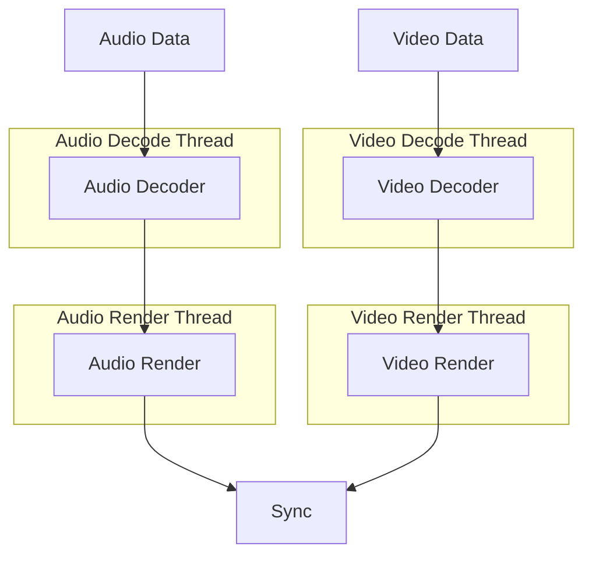

# AV_Render

`AV_Render` 是设计用于 **音频和视频播放**.  
主要采用以下办法： **基于推重播放模式**:  

- 用户提供流信息.  
- 用户将编码的流数据推入 `av_render`.  
- 玩家选择相应的代码并解码流.  
- 解码输出同步 (如果启用) 并随后提供 (e.g., 音频通过 I2S, 视频通过 LCD).  

---

## 🔹 架构

`av_render` 处理音频和视频 **平行管道** 带有单独的解码和渲染线程.  
同步模块确保根据所选内容进行正确的回放对齐 `sync_mode`.  


- **解码线索**: 处理音频和视频解码.  
- **渲染线索**: 获取解码框架， 应用同步控制， 并使他们.  

### 同步模式
- **无** → 音频和视频独立运行.  
- **音频** → 视频同步到音频时钟.  
- **时间** → 两个流都遵循系统时间或时间戳.  

---

## 🔹 抽象

### 执行

`av_render` 为音频和视频渲染提供抽象.  
用户可以从默认执行中选择或自行开发：

- **音频渲染** → `av_render_alloc_i2s_render` (输出音频通过 I2S)  
- **视频渲染** → `av_render_alloc_lcd_render` (视频通过 `esp_lcd`)  

---

## 🔹 使用指南

一个典型的回放序列看起来像这样：

1. `av_render_open`  
2. `av_render_add_audio_stream`  
3. `av_render_add_video_stream`  
4. `av_render_add_audio_data`  
5. `av_render_add_video_data`  
6. `av_render_close`  

### 重设置播放
清除当前流水并开始新鲜， 电话:  
```c
av_render_reset();
```

---

## 🔹 资源配置

`av_render` 提供灵活的资源管理， 包括:  
- 解码器渲染线程选项 (如果fifo没有设置线程)  
- 音频和视频缓冲大小(解码 fifo, 制作 fifo 等)  

有了这个设计用户，就可以在资源消耗和性能之间进行交易.  
配置是通过 `av_render_cfg_t` 或通过特定的API：

- `av_render_config_audio_fifo` — 配置音频缓冲大小  
- `av_render_config_video_fifo` — 配置视频缓冲大小  

---

## 🔹 解码器注册

正在解码 `av_render` 由 `esp_audio_codec` 联合国 `esp_video_codec`.  
只包含已注册的解码器， 确保缩小最终图像大小.  

您可以以两种方式注册解码器：

### 1. 人工登记
```c
#include "esp_aac_dec.h"
#include "esp_video_dec_h264.h"

esp_aac_dec_register();
esp_video_dec_register_sw_h264();
```

### 2. 注册全部默认 (并禁用未使用过的 `menuconfig`)
```c
#include "esp_audio_dec_default.h"
#include "esp_video_dec_default.h"

esp_audio_dec_register_default();
esp_video_dec_register_default();
```

---

## 🔹 自定义

### 自定义解码器
用户可能替换已有的解码器或添加新的解码器.  
见 `esp_audio_codec` 联合国 `esp_video_codec` 详细文件。

### 自定义渲染器
音频和视频渲染器均抽象为:  
- `audio_render_ops_t`  
- `video_render_ops_t`  

执行自定义渲染器， 将现有执行作为参考:  
- [i2s_render](render_impl/i2s_render.c)  
- [lcd_render](render_impl/lcd_render.c)  

---

## 📬 联系人支持( S)

本构成部分是 [esp-webrtc-溶液](https://github.com/espressif/esp-webrtc-solution), 规定:  
- 完成 WebRTC 函数  
- 媒体处理 (`esp_capture`, `av_render`)  
- 多种信令方法 (OpenAI, WHIP, AppRTC, 类.)  
- 实际应用的实际实例  

🔧 **错误报告或特性请求?**  
请在这里打开一个问题: [esp-webrtc-solution/issues](https://github.com/espressif/esp-webrtc-solution/issues)  

我们很乐意帮忙!  
