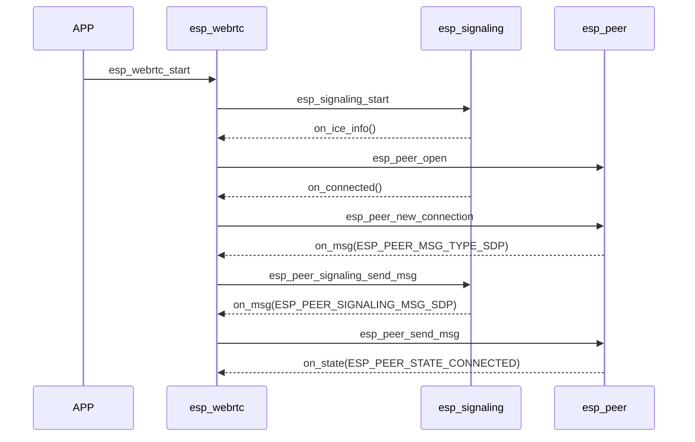
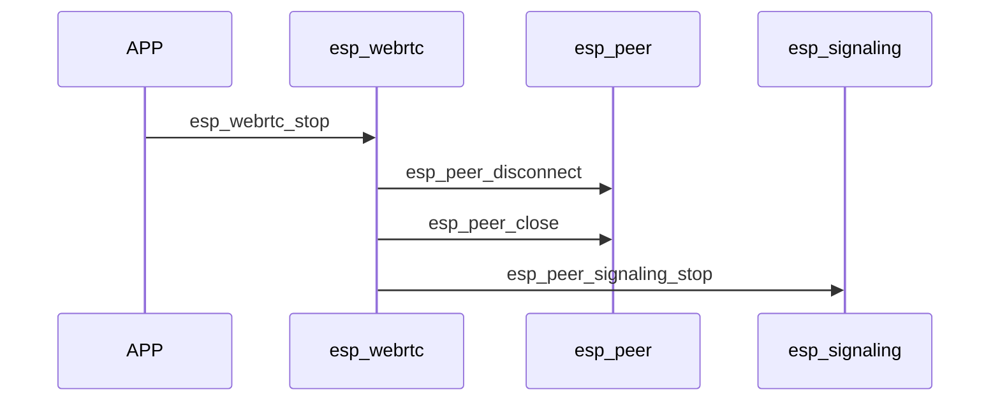
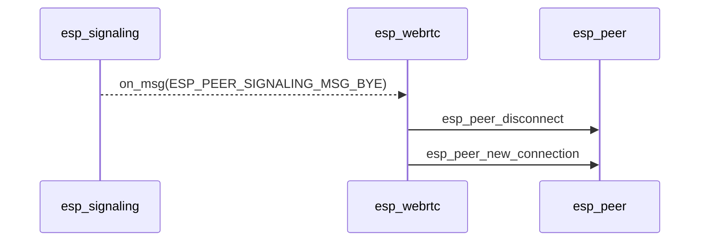

# ESP_WebRTC

`esp_webrtc` 是架构的综合解决方案 WebRTC 连接. 它的基础代码来源于 [解析器](https://github.com/sepfy/libpeer.git) 附有加强和改进。

## 增强特性

与原件相比较 `libpeer` 代码实现， `esp_peer` 遵循改进：
1. 全力支持 TURN (RFC5766 联合国 RFC8656)
2. 为多个候选人优化了连接速度
3. 既支持控制作用，也支持控制作用
4. 支助 RTP NACK 报告和处理
5. 支助 SACK (单位:千美元) SCTP, 支持巨大的数据分割和组合
6. 方便添加定制信令和对等连接执行
7. 支持在单独的任务中发送和接收以避免相互影响

## 架构

`esp_webrtc` 由三个主要部分组成：

### 1. 信令
信令用于检测对等点和交换 SDP 信息或控制命令.  
内 `esp_webrtc`, 信令抽象为 `esp_peer_signaling`.  
你可以参考 `esp_signaling_get_apprtc_impl` 实施细节的样本代码。

### 2. PeerConnection
PeerConnection 用途 ICE 查找可连接对等器 IP 和端口， 然后与对等点建立关联.  
连接建立后， 用户可以：
- 发送和接收媒体数据 (RTP 有效载荷) 通过 PeerConnection
- 发送和接收用户数据 (数据通道结束 SCTP) 通过 PeerConnection

内 `esp_webrtc` PeerConnection 抽象为 `esp_peer`.  
默认执行作为 `esp_peer_get_default_impl`, 用户仅需要时可使用 PeerConnection 函数。

### 3. WebRTC 解决方案
那个 WebRTC 解决方案结合信令， PeerConnection, 媒体系统.  
它提供了一个高级别的 API 以简化 WebRTC 应用程序开发.  
用户只需要配置音频和视频编码器等基本设置.  
`esp_webrtc` 将自动跟进：
- 抓取和传送音频和视频流
- 使用 `av_render`

用于定制， 用户只需修改信令执行。

## 使用时间 `esp_peer`
如果用户只需要对等连接协议而不需要全部 WebRTC 解决方案， 可以利用 `esp_peer` API

1. **创建一个 PeerConnection**  
   调用 `esp_peer_open` 创建 PeerConnection.  
   这个 API 收集后应援引 ICE 服务器 URL.  
   如果对等端是公共服务器， 可设置 `server_num` 改为 0。

2. **运行 PeerConnection 主循环**  
   打开后 PeerConnection, 创建一个任务来定期调用主循环: `esp_peer_main_loop`。

3. **启动新的对等连接**  
   调用 `esp_peer_new_connection` 启动新连接.  
   收集当地候选人并报告当地 SDP 通过 `on_msg` 回调.  
   用户必须发送 SDP 到信令服务器。

4. **设置远程 SDP 或候选人**  
   收到遥控器后 SDP 从信令服务器， 电话 `esp_peer_send_msg` 设置远程 SDP 或候选人。

5. **连接设置**  
   `esp_peer` 尝试通过 `on_state` 回调。

6. **发送数据**  
   - 发送音频: `esp_peer_send_audio`  
   - 发送视频: `esp_peer_send_video`  
   - 通过数据通道发送数据: `esp_peer_send_data`

7. **接收数据**  
   通过回调收到同行回复数据:  
   - `on_audio_info` 联合国 `on_audio_data` 音频信息和数据  
   - `on_video_info` 联合国 `on_video_data` 视频信息和数据  
   - `on_data` 用于数据通道消息  

8. **断开对端**  
   使用 `esp_peer_disconnect` 连接到端点。

9. **关闭 PeerConnection**  
   使用 `esp_peer_close` 关闭 PeerConnection。

## 典型调用序列 `esp_webrtc`

### 连接构建流程：

### 用户停止流量：

### 平面正常离开时断开流量 (仍然活跃的信令， 等待对等者重新加入)：

## 简单使用 `esp_webrtc`

1. 构建捕获和渲染系统。
2. 配置您的 WebRTC 设置。
3. 开始 WebRTC 电话 `esp_webrtc_start`。
4. 停下来 WebRTC 电话 `esp_webrtc_stop`。
