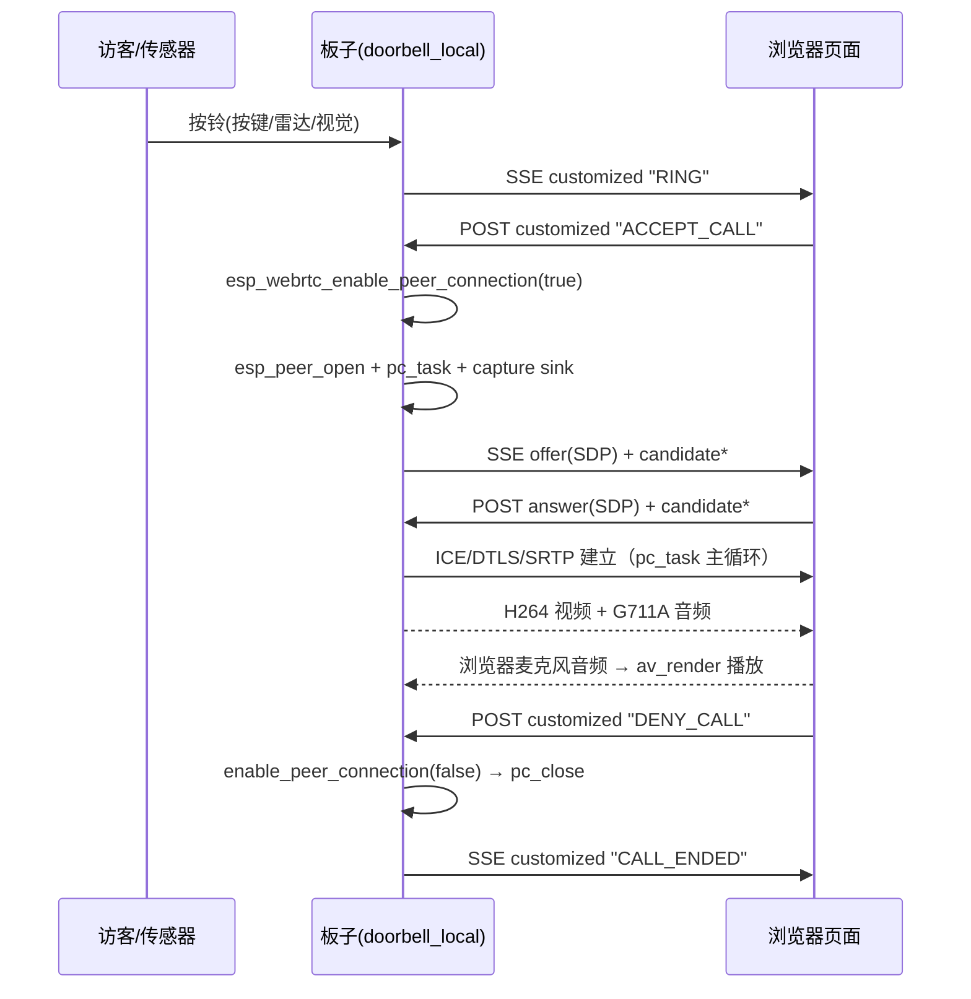

# WebRTC 会话层技术分析（ESP32-P4 + C5 门铃项目）

> 分析对象：`solutions/doorbell_local/`（应用层）+ `components/esp_webrtc/`（会话编排层）+ `components/esp_peer/`（PeerConnection 层）
> 分析方式：**只读代码走查**。文中所有结论都给出 `文件:行号` 证据；无法从本快照确认的地方明确写“未在代码中确认”。
> 目标读者：主要代码由 AI 生成、需要“从 0 讲清楚”的项目作者。

---

## 0. 一分钟总览（先看这段）

这个项目的 WebRTC 通话**不是**“板子开机就连上浏览器”，而是：

1. 板子上电 → 连 WiFi → `main.c` 的 `network_event_handler` 回调里异步调用 `start_webrtc(NULL)`（`solutions/doorbell_local/main/main.c:420-433`）。
2. `start_webrtc()` 打开一个 **HTTPS 信令服务器**（同时也是网页服务器），并且**立刻拿到 ICE 服务器信息 + 报告“信令已连接”**，但**故意不建立 PeerConnection**——因为配置里 `no_auto_reconnect = true`（`solutions/doorbell_local/main/webrtc.c:1246`）+ 显式调用 `esp_webrtc_enable_peer_connection(opened_webrtc, false)`（`webrtc.c:1336`）。
3. 浏览器打开 `https://<板子IP>/webrtc/test`（`solutions/doorbell_local/main/webrtc_test.html`），通过 **SSE（服务器发送事件）** `GET /webrtc/signal` 建立一条“设备 → 浏览器”的长连接，通过 `POST /webrtc/signal/post` 发送“浏览器 → 设备”的 JSON 消息。
4. 有人按门铃（GPIO35 按键 / 雷达 / 摄像头融合）→ `doorbell_request_ring()` 通过**信令通道**给浏览器发一条自定义命令 `RING`（`webrtc.c:333-405`）。浏览器响铃并显示“接听”按钮。
5. 用户点“接听”→ 浏览器发 `{"type":"customized","data":"ACCEPT_CALL"}` → 板子收到 `ACCEPT_CALL` → 调度 `esp_webrtc_enable_peer_connection(handle, true)`（`webrtc.c:586-600`）→ **此时才真正创建 PeerConnection、收集 ICE、生成 offer SDP**，通过 SSE 下发给浏览器。
6. 浏览器回 answer → ICE 连通 → DTLS 握手 → SRTP 加密的音视频开始双向流；板子上行：摄像头 H.264 640×480@15 + 麦克风 G711A 8kHz 单声道；下行：浏览器麦克风音频 → 板子 `av_render` 播放。
7. 挂断：浏览器发 `DENY_CALL` → 板子 `esp_webrtc_enable_peer_connection(handle, false)` 关闭 PeerConnection（但**信令 + HTTPS 服务器继续活着**），再发回 `CALL_ENDED` 确认。

一句话概括架构分工：

| 层 | 位置 | 职责 |
|---|---|---|
| 业务/状态机层 | `solutions/doorbell_local/main/webrtc.c` | 门铃状态机、自定义命令、数据通道管理、按键/雷达/门锁事件 → WebRTC 命令 |
| 会话编排层 | `components/esp_webrtc/` | 把 信令 + PeerConnection + 采集/渲染 三件事缝在一起，对上只暴露 `esp_webrtc_*` API |
| PeerConnection 层 | `components/esp_peer/` | ICE / DTLS / SRTP / SCTP(DCEP+数据通道) / RTP 收发，对外是 `esp_peer_ops_t` 抽象 |
| 媒体系统 | `solutions/doorbell_local/main/media_sys.c` + `components/av_render/` | 提供 `capture`（采集）+ `player`（渲染）两个句柄给 WebRTC 使用 |
| 信令实现 | `solutions/doorbell_local/main/webrtc_http_server.c` | 项目自定义的 HTTPS+SSE 信令，实现 `esp_peer_signaling_impl_t` 三件套 |

---

## 1. 术语速查（读懂后面内容的前提）

| 名词 | 在本项目里的含义 | 证据 |
|---|---|---|
| **SDP** | 一份文本“媒体合同”：用什么编解码、什么方向、DTLS 指纹等 | `esp_peer_signaling.h:51` |
| **ICE / candidate** | 找出一条能互通的 IP:端口 路径；candidate 就是一条候选路径 | `webrtc_http_server.c:477-480` |
| **DTLS** | 在 UDP 上做握手，用于协商 SRTP 密钥（媒体加密） | `components/esp_peer/src/dtls_srtp.c:181` |
| **SRTP** | 加密后的 RTP，真正的音视频包 | `dtls_srtp.h:242-263` |
| **SCTP / DCEP** | 承载数据通道（DataChannel）的传输；DCEP 是建链协议 | `esp_peer.h:207-211` |
| **SSE** | 浏览器 `EventSource`，一条 HTTP 长连接持续收文本事件 | `webrtc_http_server.c:178-211` |
| **offer / answer** | 发起方给 SDP 叫 offer，应答方给 SDP 叫 answer | `webrtc_test.html:1234-1329` |

---

## 2. `webrtc.c` 注册了哪些回调？（本文核心问题一）

`webrtc.c` 一共向三层注册了回调：**(A) esp_webrtc 顶层事件**、**(B) PeerConnection 级回调（通过 `esp_webrtc_cfg_t.peer_cfg`）**、**(C) 非 WebRTC 的业务回调和 RTP 变换器**。

### 2.1 回调总表

| # | 回调函数 | 注册位置 | 触发时机（谁调用） | 里面做了什么 |
|---|---|---|---|---|
| A1 | `webrtc_event_handler` | `webrtc.c:1332-1333`（`esp_webrtc_set_event_handler`，ctx = handle 本身） | `esp_webrtc` 内部 `pc_notify_app()`，由 `pc_on_state()` 在 **`pc_task` 线程的 `esp_peer_main_loop()`** 中触发（`components/esp_webrtc/src/esp_webrtc.c:230-273`） | 见 2.2 |
| B1 | `door_bell_on_cmd`（`on_custom_data`） | `webrtc.c:1239` | ① 信令收到 `CUSTOMIZED` 消息时（`esp_webrtc.c:708-717`，via=`SIGNALING`）；② 数据通道收到帧且 `video_over_data_channel==false` 时（`esp_webrtc.c:409-412`，via=`DATA_CHANNEL`） | 只处理 `via==SIGNALING`（`webrtc.c:560-562`）→ 解析门铃命令（见 §5） |
| B2 | `webrtc_data_channel_opened` | `webrtc.c:1241` | `esp_peer` 的 `on_channel_open` → `esp_webrtc.c:532-539` 转发 | `add_channel()` 把通道登记进 `user_ch[2]` 表（`webrtc.c:835-840`） |
| B3 | `webrtc_on_data` | `webrtc.c:1242` | `esp_peer` 的 `on_data` → `esp_webrtc.c:401-414` 转发 | 按 `stream_id` 找 label，校验 payload 内容并打日志（`webrtc.c:861-897`） |
| B4 | `webrtc_data_channel_closed` | `webrtc.c:1243` | `esp_peer` 的 `on_channel_close` → `esp_webrtc.c:541-548` 转发 | `remove_channel()` 释放对应槽位（`webrtc.c:899-903`） |
| C1 | `door_lock_state_changed` | `webrtc.c:1263`（`door_lock_set_state_callback`） | 门锁驱动状态变化时（`door_lock.h:17-20`） | 把 OPENING/UNLOCKED/CLOSING/LOCKED/FAULT 翻译成 `DOOR_*` 自定义命令发给浏览器（`webrtc.c:407-440`） |
| C2 | `vision_snapshot_received` | `webrtc.c:1394`（`pedestrian_detect_cfg_t.snapshot`） | 行人/人脸检测产生语义快照时 | 转交 `doorbell_report_vision_snapshot()` → SSE 推送给浏览器（`webrtc.c:469-475`） |
| C3 | `rtp_sender_get_encoded_size` / `rtp_sender_transform` / `rtp_receiver_get_encoded_size` / `rtp_receiver_transform` | `webrtc.c:1020-1050`（`setup_rtp_transformers`），**在 `PAIRED` 事件里**才真正下发给 peer（`webrtc.c:1075`） | `esp_peer` 在 RTP 包收/发前调用 | 收发 RTP 时插/剥一段 `TAIL_%u` 校验尾（`webrtc.c:905-1018`） |
| C4 | `pedestrian_detected` | **定义但未注册**（`webrtc.c:450-467`，`detect_cfg.detected = NULL` 见 `webrtc.c:1393`） | — | 当前是死代码：只用 `snapshot` 回调 |

> 未注册的回调：`esp_webrtc_peer_cfg_t.on_video_send`（`esp_webrtc.h:98` 声明，`webrtc.c` 的 cfg 里没有赋值）→ 未在代码中确认使用。

### 2.2 `webrtc_event_handler` 逐个事件解读（`webrtc.c:1052-1082`）

```c
static int webrtc_event_handler(esp_webrtc_event_t *event, void *ctx)
```

`ctx` 就是 WebRTC handle 本身（注册时传 `opened_webrtc`，`webrtc.c:1333`），所有事件都靠它判断“是不是当前这个会话”，防止旧会话的迟到事件污染新状态。

| 事件 | 处理 | 说明 |
|---|---|---|
| `ESP_WEBRTC_EVENT_CONNECTED` | `door_bell_change_state(handle, DOOR_BELL_STATE_CONNECTED)`（`webrtc.c:1055-1056`） | 媒体流已经从 `esp_webrtc` 内部启动（`esp_webrtc.c:252-254` 先 `start_stream()` 再通知 App） |
| `ESP_WEBRTC_EVENT_CONNECT_FAILED` / `DISCONNECTED` | 状态回 `DOOR_BELL_STATE_NONE`，并把两个 RTP 变换器统计清零（`webrtc.c:1057-1061`） | 让门铃回到“可以被再次按响”的状态 |
| `ESP_WEBRTC_EVENT_PAIRED` | 取 peer handle → `setup_rtp_transformers()` → 打印对端 IP:端口（`webrtc.c:1062-1079`） | 只有 PAIRED 时才拿得到 `esp_peer_get_paired_addr`（`esp_peer.h:599-612`） |
| `CONNECTING` / `DATA_CHANNEL_*` | **没有分支，静默忽略** | `esp_webrtc` 会转发这些事件（`esp_webrtc.c:250-270`），但本应用不关心 |

⚠️ 并发提醒：`PAIRED` 分支里会加 `door_bell_mutex` 再调用 `setup_rtp_transformers()` 与 `esp_peer_get_paired_addr()`（`webrtc.c:1063-1079`），而 `esp_peer` 的实现是预编译库，**无法确认这两个调用内部是否回调进 `webrtc.c`**——如果将来出现“PAIRED 卡死”类问题，这里是第一嫌疑点（未在代码中确认）。

---

## 3. 信令（signaling）实现详解（本文核心问题二）

### 3.1 抽象层：`esp_peer_signaling_impl_t` 只有三个函数

`components/esp_webrtc/include/esp_peer_signaling.h:105-128`：

```c
typedef struct {
    int (*start)(esp_peer_signaling_cfg_t* cfg, esp_peer_signaling_handle_t* sig);
    int (*send_msg)(esp_peer_signaling_handle_t sig, esp_peer_signaling_msg_t* msg);
    int (*stop)(esp_peer_signaling_handle_t sig);
} esp_peer_signaling_impl_t;
```

反向（信令 → 会话层）靠 `esp_peer_signaling_cfg_t` 里的 4 个回调（`esp_peer_signaling.h:66-100`）：`on_ice_info` / `on_connected` / `on_msg` / `on_close`。

`components/esp_webrtc/src/esp_peer_signaling.c:36-73` 只是把 impl 包一层 `signaling_wrapper_t`，没有额外逻辑。

### 3.2 本项目的 `webrtc_signaling` 实证实现：HTTPS + SSE

`webrtc.c:1254` 指定 `.signaling_impl = esp_signaling_get_http_impl()`，实现在 `solutions/doorbell_local/main/webrtc_http_server.c:596-604`：

```c
static const esp_peer_signaling_impl_t impl = {
    .start    = webrtc_http_server_init,
    .send_msg = webrtc_http_server_send_msg,
    .stop     = webrtc_http_server_deinit,
};
```

**下行通道（设备 → 浏览器）：SSE**

- `GET /webrtc/signal`（`webrtc_http_server.c:178-211`）：设置 `text/event-stream`，先发一条 `{"type":"connected"}`，再用 `httpd_req_async_handler_begin()` 把请求转成异步，随后 `xTaskCreate("signal_hdlr", 4096, prio=5)` 起发送任务（`:196-208`）。
- 发送任务 `signaling_msg_send_task`（`:107-175`）循环做四件事：
  1. 优先取 **信令队列** `signaling_queue`（SDP/candidate/bye/customized 的 JSON 字符串）并 `data: ...\n\n` 发出（`:116-128`）；
  2. 其次取 **遥测队列**（雷达事件等，`:129-137`）；
  3. 再看 **最新视觉快照**（单槽，`xQueuePeek` 去重，`:138-154`）；
  4. 每 5 秒发一次 `{"type":"heartbeat"}` 用于探活（`:158-166`）。
- 页面刷新时会话接管：新连接把旧 `event_stream->stopping = true`（`:185-190`），旧任务退出时 `httpd_req_async_handler_complete()` 并释放（`:168-172`）。

**上行通道（浏览器 → 设备）：`POST /webrtc/signal/post`**

`webrtc_signal_post_handler`（`:214-348`）解析 JSON 的 `type` 字段：

| 浏览器发的 `type` | 转成 | 处理 |
|---|---|---|
| `offer` | `ESP_PEER_SIGNALING_MSG_SDP` | `:273-282` |
| `answer` | `ESP_PEER_SIGNALING_MSG_SDP` | `:283-292`；**额外**把 SDP 里所有 `a=candidate:` 行拆出来，单独以 `CANDIDATE` 类型喂给 `on_msg`（`:294-311`） |
| `candidate` | `ESP_PEER_SIGNALING_MSG_CANDIDATE` | `:312-321` |
| `bye` | `ESP_PEER_SIGNALING_MSG_BYE` | `:322-323` |
| `customized` | `ESP_PEER_SIGNALING_MSG_CUSTOMIZED` | `:324-333`，`data` 就是命令字符串 |

最后统一 `sig_cfg.on_msg(&msg, sig_cfg.ctx)`（`:339-342`）把消息交给 `esp_webrtc`。

**发送侧序列化**：`webrtc_http_server_send_msg`（`:514-558`）把消息变成 JSON 塞进 `signaling_queue`（队列深度 10，`:24`、`:463`）：`SDP→"offer"`、`CANDIDATE→"candidate"`、`BYE→"bye"`、`CUSTOMIZED→"customized"`。**注意 `:554-556`：每次发出 SDP 后，还会把 SDP 内的 candidate 逐条再作为独立 candidate 消息重发一遍**（`resend_all_candidate`，`:491-512`）——这是一种“SDP 内嵌 + 单独重发”的兼容手段，不是标准 trickle ICE。

**启动时序很关键**：`webrtc_http_server_init`（`:445-487`）在 `start()` 内部就**同步**回调了：

```c
esp_peer_signaling_ice_info_t ice_info = {
    .is_initiator = true,
    .server_info.stun_url = "stun:stun.l.google.com:19302",
};
sig_cfg.on_ice_info(&ice_info, cfg->ctx);   // :482
sig_cfg.on_connected(cfg->ctx);             // :483
*h = (esp_peer_signaling_handle_t)signaling_queue;  // :484  handle 就是队列
```

也就是说：**板子的 ICE 配置是硬编码的，`is_initiator = true`（→ ICE controlling 角色）；`signal_url` 参数完全没被使用**（`main.c:425` 传的就是 `NULL`，`webrtc.c:1251` 把它塞进 `signaling_cfg.signal_url`，HTTP 实现根本不读）。

### 3.3 `esp_webrtc` 侧的信令胶水（`components/esp_webrtc/src/esp_webrtc.c`）

| `esp_webrtc` 回调 | 代码 | 关键行为 |
|---|---|---|
| `signal_ice_received` | `:654-664` | 存下 `ice_info`，置 `ice_info_loaded = true`；**若 `pending_connect` 为真就直接返回，不建连接** |
| `signal_connected` | `:666-679` | 置 `signaling_connected = true`；**若 `no_auto_reconnect && pending_connect` 就打印 “pending for use not enable” 并返回**；否则 `esp_peer_new_connection()` 生成 offer |
| `signal_new_msg` | `:681-730` | `BYE` → 暂停主循环、`esp_peer_disconnect()`、停流，`no_auto_reconnect==false` 时才重新 `new_connection`；`CUSTOMIZED` → 直接转给 App 的 `on_custom_data`；其余（SDP/candidate）→ `esp_peer_send_msg()` |
| `signal_closed` | `:732-739` | `signaling_connected=false`，`esp_peer_disconnect()`（注意 `rtc->pc` 可能是 `NULL`，见下方风险点） |

### 3.4 `esp_webrtc_enable_peer_connection` 与 `no_auto_reconnect` 到底做了什么

**`no_auto_reconnect`（`esp_webrtc.h:62-65` 有中文注释）**：
- 语义：对端离开后**不要自动重新进房间/重发 SDP**，一直等到应用显式调用 `esp_webrtc_enable_peer_connection(handle, true)` 为止。
- 在 `esp_webrtc.c` 里只影响两处：`:670`（信令连上时不自动建连）和 `:696`（收到 BYE 后不自动重连）。该标志会继续下传给 `esp_peer_cfg_t.no_auto_reconnect`（`:579`），供 peer 实现使用。
- 本项目的动机（可从行为推断）：门铃是“被叫”设备，一次只能服务一个访客会话，不能让信令一连上就自动建立空会话；必须等浏览器按“接听”才建流。**代码注释未直接写明动机，此处为行为推断。**

**`esp_webrtc_enable_peer_connection(handle, enable)`（`esp_webrtc.c:773-811`）**：

```c
rtc->pending_connect = !enable;       // :779  ← 这一行就把 no_auto_reconnect 的“闸门”拨了
if (!pending_connect) {
    if (rtc->pc == NULL) {            // 还没有 peer → 先建
        if (!rtc->ice_info_loaded) { ESP_LOGE("ICE info not fetched yet"); return 0; }  // :784-787
        start_peer_connection(rtc, &rtc->ice_info);   // :789 → pc_start() → esp_peer_open() + pc_task + capture sink
    }
    if (rtc->signaling_connected) {   // 信令已连 → 发 offer
        esp_peer_new_connection(rtc->pc);   // :797
        if (rtc->pause) { rtc->pause = false; SET_WAIT_BITS(PC_RESUME_BIT); }  // :799-802
    }
} else {                              // enable == false
    rtc->recv_vid_info.codec = NONE;  // :806
    stop_stream(rtc);                 // :807 停采集/发流线程 + 渲染 reset
    pc_close(rtc);                    // :808 断开并销毁 peer（rtc->pc = NULL）
}
```

`enable=true` 的完整链路（从浏览器点“接听”到 offer 发出）：

```
浏览器 POST {"type":"customized","data":"ACCEPT_CALL"}
  → webrtc_http_server.c:341  sig_cfg.on_msg()
  → esp_webrtc.c:708-717       App on_custom_data(via=SIGNALING)
  → webrtc.c:586-600           door_bell_on_cmd(): 状态置 CONNECTING，调度 peer_enable 线程
  → webrtc.c:477-533           peer_connection_change_worker(): esp_webrtc_enable_peer_connection(h, true)
  → esp_webrtc.c:779,789,797   pending_connect=false → start_peer_connection() → esp_peer_new_connection()
  → esp_webrtc.c:571-598       pc_start(): esp_peer_open(peer_cfg, esp_peer_get_default_impl(), &pc)
  → esp_webrtc.c:610           创建 "pc_task"（跑 esp_peer_main_loop）
  → esp_peer 生成本地 SDP → on_msg
  → esp_webrtc.c:275-280       pc_on_msg() → esp_peer_signaling_send_msg()
  → webrtc_http_server.c:514   JSON {"type":"offer","sdp":...} 入 signaling_queue
  → webrtc_http_server.c:116   SSE 下发到浏览器
```

---

## 4. 媒体链路（本文核心问题三）

### 4.1 媒体系统的来源

`webrtc.c:1265-1267`：

```c
esp_webrtc_media_provider_t media_provider = {};
media_sys_get_provider(&media_provider);
esp_webrtc_set_media_provider(opened_webrtc, &media_provider);
```

`media_sys_get_provider`（`media_sys.c:417-422`）返回两个句柄：

- `capture` ← `build_capture_system()`（`media_sys.c:342-360`）：V4L2/CSI 摄像头（`/dev/video0`，`media_sys.c:310-314`）+ `esp_capture_new_audio_dev_src`（`:347-350`），同步模式 `ESP_CAPTURE_SYNC_MODE_AUDIO`。
- `player` ← `build_player_system()`（`media_sys.c:362-398`）：`av_render_alloc_prompt_overlay()`（I2S 音频，带门铃提示音叠加能力）+ `av_render_alloc_lcd_render()`（本地 LCD），再用 `av_render_open()` 合成一个 `av_render` 实例。

### 4.2 采集 → 编码 → 发送

建立位置有两处：

1. **`esp_webrtc` 内部**：`pc_start()` 里对 capture sink 0 做 `esp_capture_sink_setup()`（`esp_webrtc.c:611-638`），格式由 `rtc_cfg.peer_cfg` 决定（`:613-623`）；**发送线程**是 `start_stream()` 创建的 `"pc_send"` 任务（`esp_webrtc.c:196-213`），触发点是 `ESP_PEER_STATE_CONNECTED`（`:252-254`）。
2. **应用层预配置**：当 `CONFIG_DOORBELL_SUPPORT_PEDESTRIAN_DETECT=y`（本工程 P4 默认开启，`solutions/doorbell_local/sdkconfig.defaults.esp32p4:46`）时，`webrtc.c:1276-1328` 会**提前**建好 sink 0（同参数，`:1276-1301`）和 sink 1（RGB565 320×180@2fps 供行人检测，`:1304-1328`，并 `ESP_CAPTURE_RUN_MODE_ALWAYS`）。

发送循环（`esp_webrtc.c:119-194`）：

```c
_media_send():                       // esp_webrtc.c:119-183
  音频: while (acquire_frame(audio) == OK) { esp_peer_send_audio(); release_frame(); }   // :127-141
  视频: acquire_frame(video) → 可选 on_video_send 回调 → esp_peer_send_video()           // :143-182
media_send_task():                   // esp_webrtc.c:185-194
  while (send_going) { _media_send(); sleep(20ms); }   // AUDIO_FRAME_INTERVAL = 20，:39
```

编码配置（`webrtc.c:1215-1249`）：

| 项 | 值 | 证据 |
|---|---|---|
| 音频编解码 | `ESP_PEER_AUDIO_CODEC_G711A`，8000 Hz，1 声道 | `webrtc.c:1226-1228`（`WEBRTC_SUPPORT_OPUS` **未定义**，本工程 `settings.h` 里没有该宏） |
| 视频编解码 | `ESP_PEER_VIDEO_CODEC_H264`，`VIDEO_WIDTH×VIDEO_HEIGHT@VIDEO_FPS` | `webrtc.c:1231-1236`；P4 上为 640×480@15（`settings.h:30-33`） |
| 音频方向 | `SEND_RECV`（双向对讲：板子麦克风上行 + 浏览器音频下行播放） | `webrtc.c:1237` |
| 视频方向 | `SEND_ONLY`（板子只上传视频，浏览器不下发视频） | `webrtc.c:1238`。注意 `pc_start()` 只用 `audio_dir` 决定是否清空 `play_handle`（`esp_webrtc.c:626-630`），所以视频 `SEND_ONLY` **不影响**音频播放路径 |
| 额外配置 | `esp_peer_default_cfg_t.agent_recv_timeout = 500` | `webrtc.c:1215-1217, 1247-1248` |

**采集的启停权归应用**：`esp_webrtc_set_no_auto_capture(opened_webrtc, true)`（`webrtc.c:1271`，注释解释“保持摄像头管线常活，避免挂断后重开后视频延迟”）。于是：
- `esp_webrtc.c:199-200`：不自动 `esp_capture_start`，改为 `esp_capture_sink_enable(ALWAYS)`；
- `esp_webrtc.c:221-225`：停止时也不 `esp_capture_stop`，只 disable sink；
- 应用自己在 `webrtc.c:1387` 显式 `esp_capture_start(media_provider.capture)`（仅行人检测使能时）；`stop_webrtc()` 里才 `esp_capture_stop`（`webrtc.c:1467`）。

### 4.3 接收 → 解码 → 渲染

触发点在 `esp_peer` 回调（由 `pc_task` 的主循环驱动），实现在 `esp_webrtc.c`：

| 回调 | 代码 | 行为 |
|---|---|---|
| `pc_on_audio_info` | `esp_webrtc.c:354-364` | 把远端音频参数转成 `av_render_audio_info_t` → `av_render_add_audio_stream()`（动态挂解码器） |
| `pc_on_video_info` | `esp_webrtc.c:318-326` | 同上，H264/MJPEG → `av_render_add_video_stream()` |
| `pc_on_audio_data` | `esp_webrtc.c:366-382` | `av_render_add_audio_data()`（G711A/U 强制 8000/1ch，见 `:344-346`） |
| `pc_on_video_data` | `esp_webrtc.c:384-399` | `av_render_add_video_data()` |
| `pc_on_data` | `esp_webrtc.c:401-430` | `video_over_data_channel == false` 时转给 App 的 `on_data` + `on_custom_data`；否则把数据当视频帧塞给渲染器 |

真正的解码/播放线程在 `components/av_render` 内部：`"Adec"` / `"ARender"` / `"Vdec"` / `"VRender"`（`components/av_render/src/av_render.c:1002, 1133, 1326, 1514`）。

---

## 5. 数据通道与门铃自定义命令（本文核心问题四）

### 5.1 数据通道：**两条，只用于吞吐/回环自测**

- 配置：`.enable_data_channel = true`、`.manual_ch_create = true`（`webrtc.c:1244-1245`）。注释说明 `manual_ch_create` 是“作为 SCTP client 时不自动建通道”（`esp_webrtc.h:59-60`）——实际通道由**浏览器侧**创建：`peerConnection.createDataChannel('channel1')` / `('channel2')`（`webrtc_test.html:1153-1154`）。
- 登记：`add_channel()` 把 label / stream_id 存进 `user_ch[2]`（`webrtc.c:97` 定义 2 个槽位；`webrtc.c:670-714`）。匹配键是 `owner_handle + stream_id`，label 用 `strdup` 保存；label 为空时用 `'0' + stream_id % 10` 兜底（`:676-679`）。
- 发送：`data_thread_hdlr`（`webrtc.c:762-833`）**每 1000 ms** 向每个已知通道发一条 **8192 字节字符串**：头部是 `"Send to %s count %d\n"`，其余用 `CNT_TO_CHAR(count)` 填充（`:760, 805-810`），通过 `esp_peer_send_data()`（`esp_peer_data_channel_type_t = ESP_PEER_DATA_CHANNEL_STRING`）发出。
- 接收：`webrtc_on_data`（`:861-897`）按 `stream_id` 找 label，调用 `verify_data()`（`:842-859`）校验后打日志。

⚠️ **实测会一直报校验失败**：发送内容是 `"Send to channel1 count 0\n"`，而 `verify_data()` 用 `strstr(data, "the ")` 找计数（`:845`），实际字符串里**没有 "the "**，因此 `verified` 恒为 `false`，每次收包都会走 `ESP_LOGE("Get data label %s verify:%d ...")`（`:884-888`）。这是从别处移植时留下的不匹配，属于**可确认的代码不一致**（不影响通话，只刷日志）。

- 关闭：`close_data_channel(int id)`（`webrtc.c:635-668`）：加 `webrtc_api_mutex` + `data_channel_mutex` → 从 `user_ch[id]` 取 label → `esp_webrtc_get_peer_connection()` → `esp_peer_close_data_channel(peer, label)`。命令行 `close <idx>` 调用（`main.c:237-241`）。

### 5.2 门铃业务命令**不走数据通道**，走信令

关键宏（`webrtc.c:42-43`）：

```c
#define SEND_CMD(webrtc, cmd) \
    esp_webrtc_send_custom_data(webrtc, ESP_WEBRTC_CUSTOM_DATA_VIA_SIGNALING, (uint8_t *)cmd, strlen(cmd))
```

`esp_webrtc_send_custom_data(..., VIA_SIGNALING, ...)` → `esp_peer_signaling_send_msg(type=CUSTOMIZED)`（`esp_webrtc.c:904-911`）→ `webrtc_http_server_send_msg` 序列化成 `{"type":"customized","data":"RING"}` → SSE 下发。

**这意味着：自定义命令只要信令（SSE）通就能到达，不需要 PeerConnection 建立。** 这正是“按门铃 → 浏览器响铃”能在建流之前发生的原因。

**命令字典**（`webrtc.c:26-39`）：

| 命令 | 方向 | 触发点 | 浏览器反应（`webrtc_test.html`） |
|---|---|---|---|
| `RING` | 板 → 浏览器 | `doorbell_request_ring()`（`webrtc.c:373`） | 播放门铃音、启用“接听”（`:1036-1042`） |
| `RING_STOPPED` | 板 → 浏览器 | `ring_stop_worker` 4 秒后（`webrtc.c:304-305, 293`） | 停止门铃音（`:1043-1046`） |
| `ACCEPT_CALL` | 浏览器 → 板 | 点击“接听”（`html:812`） | 板：状态→CONNECTING，建 PeerConnection（`webrtc.c:586-600`） |
| `DENY_CALL` | 浏览器 → 板 | 点击“挂断”（`html:844`） | 板：状态→DISCONNECTING，关 PeerConnection（`webrtc.c:601-619`） |
| `CALL_ENDED` | 板 → 浏览器 | 关闭成功后（`webrtc.c:519-522`） | 浏览器收尾（`:1066-1069`） |
| `CALL_END_FAILED` | 板 → 浏览器 | 关闭失败（`webrtc.c:519-525`）；`DENY_CALL` 调度失败时也会发（`webrtc.c:617`） | 提示重试（`:1070-1078`） |
| `OPEN_DOOR` | 浏览器 → 板 | 点击“开门”（`html:830`） | 板：`door_lock_request_open()`（`webrtc.c:574-585`） |
| `DOOR_OPENING/OPENED/CLOSING/LOCKED/FAILED` | 板 → 浏览器 | 门锁状态回调（`webrtc.c:420-438`） | 更新开门按钮/提示（`:1013-1035`） |
| `PEDESTRIAN_DETECTED` | 板 → 浏览器 | `pedestrian_detected()`（`webrtc.c:455-462`，**该回调当前未注册**） | 记录事件（`:1047-1050`） |
| `ENABLE_RTP_TRANSFORMER` / `DISABLE_RTP_TRANSFORMER` | 浏览器 → 板 | RTP 变换开关按钮（`html:1416-1426`） | 只置 `rtp_transformer_enabled` 标志（`webrtc.c:620-629`） |

⚠️ 注意与图形界面理解的差异：页面上还有 `radar_event` / `vision_state` / `heartbeat` 三类 SSE 消息（`html:976-982`），它们**不是 WebRTC 自定义命令**，而是走 `webrtc_http_server_publish_event()` / `publish_latest_vision()` 这条独立的遥测队列（`webrtc_http_server.c:54-92`，调用点如 `main.c:192-195, 91-95`）。

### 5.3 浏览器 → 板命令的解析（`door_bell_on_cmd`，`webrtc.c:557-633`）

```c
if (via != ESP_WEBRTC_CUSTOM_DATA_VIA_SIGNALING) return 0;   // :560-562  ← 数据通道来的命令被直接丢弃
... 加 door_bell_mutex ...
const char *cmd = (const char *)data;                         // :573
SAME_STR(cmd, "OPEN_DOOR")  → door_lock_request_open()        // :574-585
SAME_STR(cmd, "ACCEPT_CALL")→ CONNECTING + schedule_peer_connection_change(true)   // :586-600
SAME_STR(cmd, "DENY_CALL")  → DISCONNECTING + schedule_peer_connection_change(false) // :601-619
SAME_STR(cmd, "ENABLE_RTP_TRANSFORMER" / "DISABLE_...")       // :620-629
```

`SAME_STR(a,b)` 是宏 `strncmp(a, b, sizeof(b)-1) == 0`（`webrtc.c:41`）——**前缀匹配**，例如 `"RING_STOPPED"` 会被当成……不会被误判成 `"RING"`（`RING` 是浏览器发给板的方向，板侧只比较 `OPEN_DOOR/ACCEPT_CALL/DENY_CALL/ENABLE_/DISABLE_`），但**浏览器发 `"ACCEPT_CALL_XXX"` 同样会被接受**，这是该宏的固有宽松性，值得在汇报中提一句（不是 bug，但不够严格）。

### 5.4 RTP 变换器（数据面“插桩”）

- 目的：验证 WebRTC Encoded Transform（浏览器侧 `RTCRtpScriptTransform`，`html:1288-1318`）与 `esp_peer` 的 `set_rtp_transformer`（`esp_peer.h:497-498`）能否互通。
- 板侧实现在 `webrtc.c:905-1018`：**发送**时把 `[RTP头12B][4B 原始payload长度][原始payload][4B 尾部长度]["TAIL_%u"]` 拼成一个包（`:939-953`）；**接收**时按同样格式还原（`:987-1017`）。payload_type ≥ 96（视频）直接返回 `ESP_PEER_ERR_NOT_SUPPORT` 跳过（`:909, 927, 966`）。
- 生效时机：只在 `PAIRED` 事件里注册（`webrtc.c:1075`）→ **通话中途用按钮开关，要等下一次 PAIRED（下一次通话）才真正生效**（可由 `webrtc.c:1020-1050` 只被 `1075` 调用来确认）。
- 统计计数在 `DISCONNECTED/CONNECT_FAILED` 时清零（`webrtc.c:1059-1061`），每 100 帧打一条日志（`:955-957, 1013-1015`）。

---

## 6. 与业务层的接口（本文核心问题五）

声明在 `common.h`，实现在 `webrtc.c`：

| 接口 | 位置 | 作用与实现要点 |
|---|---|---|
| `int doorbell_webrtc_init(void)` | 声明 `common.h:32`；实现 `webrtc.c:182-185` | **只做一件事**：`door_bell_sync_init()` 创建 4 把互斥锁（`door_bell_mutex` / `webrtc_api_mutex` / `webrtc_lifecycle_mutex` / `data_channel_mutex`，`:136-180`）。必须在 `app_main` 早期调用（`main.c:442-445`），因为所有其它接口都依赖锁。 |
| `int start_webrtc(char *url)` | 声明 `common.h:43`；实现 `webrtc.c:1171-1407` | ① 校验锁已建 + WiFi 已连（`:1175-1182`）；② 拿 `webrtc_lifecycle_mutex`（`:1183`）实现“启停串行化”；③ 先停旧 worker（`:1188`）、`esp_webrtc_close(previous_handle)`（`:1211`）实现可重入重启；④ 构造 `esp_webrtc_cfg_t` 并 `esp_webrtc_open`（`:1215-1262`）；⑤ 门锁回调（`:1263`）+ 媒体 provider（`:1265-1267`）+ `no_auto_capture`（`:1271`）；⑥ 行人检测 sink 预配置（`:1273-1329`）；⑦ 事件回调（`:1332`）+ **先禁用自动建连**（`:1336`）+ `esp_webrtc_start`（`:1339`）；⑧ 发布 handle 与状态（`:1348-1358`）；⑨ 启动门铃 worker（`:1360`）；⑩ 播放“加入成功”提示音（`:1384`）；⑪ 启动采集与行人检测（`:1385-1401`）。**`url` 参数实际未被 HTTP 信令实现使用**（见 §3.2）。 |
| `void query_webrtc(void)` | 声明 `common.h:48`；实现 `webrtc.c:1409-1421` | 加 `webrtc_api_mutex` → `esp_webrtc_query(handle)`。`esp_webrtc_query` 只在 `peer_state == CONNECTED` 时打印收发计数并清零（`esp_webrtc.c:945-978`），否则返回 `ESP_PEER_ERR_WRONG_STATE`（无日志）。`main.c:475-478` 每 2 秒调用一次，当作心跳/统计。 |
| `int stop_webrtc(void)` | 声明 `common.h:57`；实现 `webrtc.c:1423-1479` | 与 `start` 对称：停 worker（`:1436`）→ 取 handle 并置空（`:1453-1454`）→ 状态回 NONE（`:1456`）→ 行人检测路径下 `stop_pedestrian_detection()` + `esp_capture_stop()`（`:1463-1469`）→ `esp_webrtc_close(handle)`（`:1470`）→ `clear_channels()`（`:1471`）。这条路径是**真正关掉采集**的地方（对比 `start_webrtc` 里“采集常驻”的设计，见 `webrtc.c:1269-1271` 的注释）。 |
| `void send_cmd(char *cmd)` | 声明 `common.h:62`；实现 `webrtc.c:1084-1089` | **只认 `"ring"`**：`if (SAME_STR(cmd,"ring")) doorbell_request_ring("command");`。命令行 `cmd [ring]`（`main.c:243-247`）用它做人工触发。 |
| `int close_data_channel(int idx)` | 声明 `common.h:82`；实现 `webrtc.c:635-668` | 见 §5.1。注意形参名在头文件里是 `idx`、实现里是 `id`，语义是 **`user_ch[]` 槽位下标**而不是 stream_id。 |
| `doorbell_request_ring(const char *source)` | 声明 `common.h:67`；实现 `webrtc.c:333-405` | 门铃“按响”的唯一入口，见下。 |

### 6.1 `doorbell_request_ring()` 流程（门铃业务的心脏）

调用者：按键线程 `key_monitor_thread`（`webrtc.c:1117-1118`）、`send_cmd("ring")`（`:1087`）、雷达/视觉融合（`main.c:46-53` 的 `request_sensor_ring()`，被 `main.c:82, 127, 206, 210` 调用）。

```
1. 加 webrtc_api_mutex（:340-345）→ 加 door_bell_mutex（:346-352）
2. ring_handle = webrtc;  policy = doorbell_ring_policy_evaluate(handle!=NULL, state==NONE)   :354-356
      → doorbell_ring_policy.c:3-13：未就绪=NOT_READY；非空闲=BUSY；否则 ACCEPTED
3. ACCEPTED → state = RINGING; reserved_generation = ++ring_generation                          :358-361
4. 解 door_bell_mutex，保持 webrtc_api_mutex，SEND_CMD(ring_handle, "RING")  通过信令发给浏览器   :366-373
5. 发送成功且状态仍是 RINGING → play_tone(RING)（本地 4 秒门铃音，:387-391）
                                → schedule_ring_stop(handle, generation)（:393）
6. schedule_ring_stop → ring_stop_worker 睡 4000ms 后，若 handle 未变且状态仍 RINGING 且 generation 未被抢占
   → SEND_CMD("RING_STOPPED")                                                                  :290-314
```

`ring_generation`（`webrtc.c:99`）+ `target_handle` 双重校验，用来丢弃**过期的延时任务**（例如 4 秒内又来了新的一次按铃/挂断）。这是一个很值得在汇报里讲的“AI 生成代码里少见的正确性细节”。

### 6.2 状态机 `door_bell_state_t`（`webrtc.c:48-54`）

```
NONE ──(ring: 策略 ACCEPTED)──▶ RINGING ──(ACCEPT_CALL)──▶ CONNECTING ──(事件 CONNECTED)──▶ CONNECTED
  ▲                                 │                            │                            │
  │                                 │(DENY_CALL)                 │(DENY_CALL)                 │(DENY_CALL)
  │                                 ▼                            ▼                            ▼
  └────────────(peer disable 成功 / 事件 DISCONNECTED / CONNECT_FAILED)──── DISCONNECTING ────┘
```

实现要点：
- 状态改写集中在 `door_bell_change_state_locked()`（`:245-253`）；进入 `CONNECTING/DISCONNECTING/NONE` 会 `stop_music()`（停本地门铃音）。
- 事件回调走 `door_bell_change_state(source_handle, state)`（`:255-273`）：**丢弃非当前 handle 的事件**（`:264-265`），并**忽略 `DISCONNECTING` 期间迟到的 `CONNECTED`**（`:266-268`）。
- `restore_peer_change_state_locked()`（`:275-288`）：如果异步“启用/禁用 peer”失败且状态还是当时那个期望值，就回滚状态，必要时**重新播放门铃音**。
- worker 通过 `media_lib_thread_create_from_scheduler()` 起独立线程，成功才改状态，失败则回滚（`:477-533, 535-555`）。

---

## 7. 线程 / 任务模型（本文核心问题六）

### 7.1 本会话层与门铃业务相关的任务

| 任务名 | 创建位置 | 栈 | 优先级 | 核心 | 说明 |
|---|---|---|---|---|---|
| `pc_task` | `esp_webrtc.c:609-610` | **25 KB** | **18** | **1** | 循环调用 `esp_peer_main_loop()`，每轮 `sleep(10ms)`（`esp_webrtc.c:282-297`）。**所有 `esp_peer` 回调（状态/媒体/数据/信令消息）都在这个线程里跑**（`esp_peer.h:553-558` 明确“默认实现没有额外线程，全部在该循环触发”） |
| `pc_send` | `esp_webrtc.c:205` | 未覆盖（默认值未在代码中确认） | 默认 | 默认 | 采集→`esp_peer_send_audio/video`，周期 20 ms（`esp_webrtc.c:185-194`） |
| `signal_hdlr` | `webrtc_http_server.c:203`（`xTaskCreate`） | **4096 B** | **5** | 未绑定 | SSE 下行发送循环；同时承担遥测/视觉快照推送与 5 秒心跳（`:107-175`） |
| `Key` | `webrtc.c:1138-1139` | 默认（未确认） | 默认 | 默认 | GPIO35 按铃轮询，50 ms 一次（`:1091-1126`） |
| `data` | `webrtc.c:1158-1159` | 默认（未确认） | 默认 | 默认 | 数据通道 8192B/秒压测发送（`:762-833`） |
| `ring_stop` | `webrtc.c:325-326` | 默认（未确认） | 默认 | 默认 | 一次性延时 4 秒发 `RING_STOPPED`（`:290-314`） |
| `peer_enable` / `peer_disable` | `webrtc.c:548-550` | 默认（未确认） | 默认 | 默认 | 异步执行 `esp_webrtc_enable_peer_connection()`，避免在 `pc_task` 回调里同步关自己（`:477-533`） |
| `music_player` | `media_sys.c:555` | 默认（未确认） | 默认 | 默认 | 播放 ring/open/join AAC 提示音（`:483-542`） |
| `prompt_fallback` | `doorbell_audio_render.c:271-272` | 默认（未确认） | 默认 | 默认 | 开门提示音混入通话音频的兜底路径 |
| `ARender` / `VRender` / `Adec` / `Vdec` | `av_render.c:1002 / 1133 / 1326 / 1514` | 默认（未确认） | 默认 | 默认 | 音频/视频解码与渲染线程 |
| `door_lock` | `door_lock.c:173` | 3072 B（`door_lock.c:19`） | 见源码 | — | 舵机门锁 |
| `ld2450_uart` | `radar_ld2450.c:233` | 4096 B（`radar_ld2450.c:141`） | 见源码 | — | 雷达串口 |
| console REPL | `main.c:290-294` | 10 KB | **22** | — | 串口命令行（`start`/`stop`/`cmd`/`close`/`i`/…） |
| HTTP(S) server | `esp_https_server` 内部 | 8192 B（`webrtc_http_server.c:380`） | — | — | 页面/SSE/信令 POST 的宿主 |
| `esp_peer` 内部收发任务 | 预编译库 `components/esp_peer/libs/esp32p4/libpeer_default.a` | 未在代码中确认 | 未确认 | 未确认 | `esp_peer/README.md:27` 声称“非阻塞 send/receive 有专门任务”，但源码不在本快照 |

### 7.2 调度覆盖只发生在 `main.c` 的 `thread_scheduler()`

`main.c:439-440` 注册了两个调度钩子：

```c
esp_capture_set_thread_scheduler(capture_scheduler);   // capture 线程也走同一套规则
media_lib_thread_set_schedule_cb(thread_scheduler);
```

`thread_scheduler()`（`main.c:361-395`）**只按线程名改写**这些名字：

| 线程名 | 改写结果 | 证据 |
|---|---|---|
| `venc_0` | priority = 10（S3 上栈 20 KB） | `main.c:363-369` |
| `aenc_0` | 栈 40 KB、priority 10、**core 1**（仅 `WEBRTC_SUPPORT_OPUS` 生效，本工程未定义） | `main.c:370-377` |
| `AUD_SRC` | priority = 15 | `main.c:378-379` |
| `detect` | 栈 24 KB、priority 8 | `main.c:380-383` |
| `pc_task` | **栈 25 KB、priority 18、core 1** | `main.c:384-388` |
| `detect_filter` | priority = 15 | `main.c:389-391` |
| `start` | 栈 6 KB | `main.c:392-394` |

其它名字（`pc_send`、`Key`、`data`、`ring_stop`、`peer_enable`、`signal_hdlr`、`ARender`…）**不匹配任何分支**，因此拿到的是 `media_lib_adapter`（`espressif/media_lib_adapter` 外部托管组件，**本快照未包含其源码**）里的默认栈/优先级 → “未在代码中确认”。

`capture_scheduler()`（`main.c:397-409`）额外把 capture 线程栈强制放到 **PSRAM（`stack_in_ext = true`）**。

---

## 8. 关键时序（本文核心问题七）

### 8.1 全景文字时序图

```
【阶段 0：启动】
app_main(main.c:435)
 ├─ media_lib_add_default_adapter() / 注册两个调度钩子(main.c:438-440)
 ├─ init_board() / doorbell_webrtc_init()（建 4 把锁）(main.c:441-445)
 ├─ door_lock_init / radar_ld2450_init / media_sys_buildup（建 capture+player）(main.c:455-472)
 ├─ init_console()  (main.c:473)
 └─ network_init(WIFI_SSID, WIFI_PASSWORD, network_event_handler) (main.c:474)
        └─ 连上 WiFi 后回调 network_event_handler(true) → RUN_ASYNC(start){ start_webrtc(NULL); } (main.c:420-427)

【阶段 1：起信令（还没有 PeerConnection）】
start_webrtc(NULL) (webrtc.c:1171)
 ├─ esp_webrtc_open(cfg)                                    (webrtc.c:1257)  配置：G711A 8k/1ch + H264 640x480@15 + SEND_RECV/SEND_ONLY
 ├─ esp_webrtc_set_media_provider(capture, player)           (webrtc.c:1265-1267)
 ├─ esp_webrtc_set_no_auto_capture(true)                     (webrtc.c:1271)
 ├─ [行人检测] 预建 sink0 / sink1(RGB565 320x180@2, ALWAYS)  (webrtc.c:1276-1328)
 ├─ esp_webrtc_set_event_handler(webrtc_event_handler)       (webrtc.c:1332)
 ├─ esp_webrtc_enable_peer_connection(handle, false)  ← 关闸门，pending_connect = true   (webrtc.c:1336)
 ├─ esp_webrtc_start(handle)                                 (webrtc.c:1339)
 │     └─ esp_peer_signaling_start(http_impl)               (esp_webrtc.c:890)
 │           └─ webrtc_http_server_init()                   (webrtc_http_server.c:445)
 │                 ├─ 建 3 个队列 + 起 https server (端口 443, 证书内置)  (:447-475)
 │                 ├─ on_ice_info(is_initiator=true, stun.l.google.com:19302)  (:477-482)
 │                 │     └─ signal_ice_received() → ice_info_loaded=true，但因 pending_connect 不建 peer (esp_webrtc.c:654-664)
 │                 └─ on_connected()                        (:483)
 │                       └─ signal_connected() → signaling_connected=true，
 │                          因 no_auto_reconnect && pending_connect，打印并 return（不建 peer、不发 offer）(esp_webrtc.c:666-679)
 ├─ webrtc = handle；状态 = NONE                              (webrtc.c:1348-1358)
 ├─ start_doorbell_workers() → 起 "Key" 与 "data" 线程        (webrtc.c:1360)
 └─ play_tone(JOIN_SUCCESS)（本地提示音）                     (webrtc.c:1384)

【阶段 2：浏览器打开页面】
浏览器 GET https://<ip>/webrtc/test                → 返回内嵌 HTML (webrtc_http_server.c:351-360)
浏览器 new EventSource('/webrtc/signal')           → GET /webrtc/signal (webrtc_http_server.c:178)
   ├─ 立刻收到 data: {"type":"connected"}
   └─ 起 "signal_hdlr" 任务持续推送事件 (prio 5)

【阶段 3：按门铃（业务触发，仍然没有 PeerConnection）】
按键/雷达/视觉 → doorbell_request_ring(source)  (webrtc.c:333)
   ├─ 状态 NONE→RINGING，++ring_generation      (webrtc.c:358-361)
   ├─ 若有活跃 peer：SEND_CMD(handle,"RING")  → signaling CUSTOMIZED → JSON 入队 → SSE → 浏览器响铃
   │     (esp_webrtc.c:904-911 → webrtc_http_server.c:535-538 → :116-128 → html:1036)
   ├─ play_tone(RING) 本地也响 4 秒              (webrtc.c:387)
   └─ schedule_ring_stop(handle, gen) → 4s 后 SEND_CMD("RING_STOPPED")  (webrtc.c:290-314)

【阶段 4：接听 → 建 PeerConnection（关键分水岭）】
浏览器 POST {"type":"customized","data":"ACCEPT_CALL"}   (html:812, 913-918)
 → webrtc_signal_post_handler 解析 → sig_cfg.on_msg()     (webrtc_http_server.c:324-341)
 → signal_new_msg() 识别 CUSTOMIZED → door_bell_on_cmd()  (esp_webrtc.c:708-717 → webrtc.c:557)
 → 状态 RINGING→CONNECTING；schedule_peer_connection_change(handle, enable=true)  (webrtc.c:591-599)
 → 新线程 "peer_enable" → esp_webrtc_enable_peer_connection(handle, true)          (webrtc.c:495)
      ├─ pending_connect = false → start_peer_connection()                        (esp_webrtc.c:779-793)
      │     └─ pc_start(): esp_peer_open(伺服 stun 配置, role=CONTROLLING)         (esp_webrtc.c:566-640)
      │           ├─ 起 "pc_task"（25KB/prio18/core1），跑 esp_peer_main_loop       (esp_webrtc.c:609-610)
      │           └─ esp_capture_sink_setup(capture, 0, ...)（G711A + H264）        (esp_webrtc.c:634)
      └─ signaling_connected 已为真 → esp_peer_new_connection(pc)                 (esp_webrtc.c:796-802)
            └─ esp_peer 收集候选 + 生成 offer SDP → on_msg
                 → pc_on_msg() → esp_peer_signaling_send_msg(SDP)                  (esp_webrtc.c:275-280)
                 → JSON {"type":"offer","sdp":...} 入 signaling_queue              (webrtc_http_server.c:524-527)
                 → 紧接着把 SDP 内 a=candidate: 逐条补发为 candidate 消息          (webrtc_http_server.c:554-556, 491-512)
                 → SSE 下发浏览器                                                  (webrtc_http_server.c:116-128)

【阶段 5：ICE + DTLS + 媒体】
浏览器 handleOffer(): setRemoteDescription(offer) → createAnswer() → setLocalDescription()  (html:1234-1329)
浏览器 POST {"type":"answer","sdp":...} + 若干 {"type":"candidate",...}                     (html:1184-1196, 1321-1324)
 → webrtc_signal_post_handler: answer SDP 整包 + 拆出的 a=candidate: 逐条喂 on_msg
 → signal_new_msg() → esp_peer_send_msg()  (SDP 或 CANDIDATE)                (esp_webrtc.c:719-728)
 → esp_peer(在 pc_task 里) 完成:
      ICE 配对 → ESP_PEER_STATE_CANDIDATE_GATHERING / PAIRING / PAIRED / CONNECTING
      DTLS 握手（mbedTLS，强制 DTLS1.2，自签证书 + SHA-256 指纹，见 components/esp_peer/src/dtls_srtp.c:181,193,194）
      SRTP 密钥派生 → 媒体可加密收发
 → 状态回调 pc_on_state() 转成 esp_webrtc 事件:                    (esp_webrtc.c:240-273)
      PAIRED    → ESP_WEBRTC_EVENT_PAIRED    → webrtc_event_handler: setup_rtp_transformers + 打印对端 IP (webrtc.c:1062-1079)
      CONNECTED → start_stream() 起 "pc_send" → ESP_WEBRTC_EVENT_CONNECTED → 状态 CONNECTED (esp_webrtc.c:252-254, webrtc.c:1055)
 媒体:
      上行：capture(sink0, G711A/H264) → _media_send() → esp_peer_send_audio/video → SRTP → 浏览器
      下行：浏览器麦克风 → SRTP → on_audio_data → av_render → I2S 扬声器(带开门提示音叠加)

【阶段 6：挂断 / 断开】
方式 A（用户挂断，正常路径）：
  浏览器 POST {"type":"customized","data":"DENY_CALL"}         (html:844)
   → door_bell_on_cmd(): 状态→DISCONNECTING，schedule_peer_connection_change(false)  (webrtc.c:601-619)
   → "peer_disable" 线程 → esp_webrtc_enable_peer_connection(handle, false)         (webrtc.c:495)
        → pending_connect=true；stop_stream()（停 "pc_send"、disable sink、av_render_reset）
        → pc_close()（esp_peer_disconnect → 等 pc_task 退出 → esp_peer_close）       (esp_webrtc.c:508-530, 804-809)
        → 成功后状态 NONE，SEND_CMD("CALL_ENDED")；失败发 "CALL_END_FAILED"           (webrtc.c:507-526)
   ★ 注意：signaling 与 HTTPS 服务器仍然存活，所以浏览器还能再按一次“接听”重连

方式 B（浏览器发 BYE）：
  浏览器 POST {"type":"bye"} → signal_new_msg(BYE): 暂停 pc_task、esp_peer_disconnect、
  stop_stream；因 no_auto_reconnect=true，**不会**自动重连                 (esp_webrtc.c:684-706)

方式 C（应用主动停服）：stop_webrtc() → stop worker → esp_webrtc_close() → esp_webrtc_stop()
  → stop_stream + pc_close + esp_peer_signaling_stop(→ 关 SSE 会话、停 https server)  (esp_webrtc.c:980-995, webrtc_http_server.c:561-594)
  ★ 代码里没有向浏览器主动发 BYE 或 CALL_ENDED，浏览器只能靠 SSE 中断/连接状态变化感知（未在代码中确认有其他通知路径）
```

### 8.2 精简 mermaid（可直接放进汇报 PPT）



---

## 9. 锁与并发模型

`webrtc.c` 用了 4 把锁，分工非常清晰（`webrtc.c:88-93` 定义，`:136-180` 创建）：

| 锁 | 保护对象 | 典型持有时机 |
|---|---|---|
| `webrtc_api_mutex` | **所有对 `esp_webrtc_*` API 的调用**（串行化） | `start_webrtc`（`:1192-1402`）、`stop_webrtc`（`:1441-1473`）、`close_data_channel`（`:639`）、`data_thread_hdlr`（`:771-823`）、`doorbell_request_ring`（`:340-403`）、`peer_connection_change_worker`（`:482-528`） |
| `door_bell_mutex` | `door_bell_state`、`webrtc` 句柄、worker 开关标志 | 几乎每个回调都加锁读状态；`door_bell_change_state`（`:258`）等 |
| `webrtc_lifecycle_mutex` | **启停串行化**（只被 `start_webrtc`/`stop_webrtc` 持有） | `:1183` / `:1431` |
| `data_channel_mutex` | `user_ch[2]` 通道表 | `add/remove/clear_channel`、`data_thread_hdlr`、`close_data_channel` |

**固定加锁顺序**：`webrtc_lifecycle_mutex` → `webrtc_api_mutex` → `door_bell_mutex` / `data_channel_mutex`（见 `:1183→1192→1198`、`:1431→1441→1447`、`:340→347`）。所有路径都遵守同一顺序，这是这份 AI 生成代码里做得比较扎实的部分。

`doorbell_worker_enabled()` / `doorbell_worker_finished()`（`:193-215`）用 `monitor_key` / `data_thread_enabled` / `key_thread_active` / `data_running` 四个标志实现**协作式线程退出**；`stop_doorbell_workers()`（`:217-243`）用 10 ms 轮询等待它们退出。

---

## 10. 值得在汇报里点出的设计取舍与风险

### 10.1 设计取舍（可以正向讲）

1. **“信令常连、媒体按需”**：HTTPS+SSE 常驻，PeerConnection 只在接听时建立（`no_auto_reconnect=true` + `enable_peer_connection(false)`），既省电省流，又保证“按铃即响”的通知链路不受建流失败影响。
2. **摄像头管线常活**：`esp_webrtc_set_no_auto_capture(true)`（`webrtc.c:1271`，含注释说明原因），避免每次通话重建 P4 视频管线造成首帧延迟。
3. **媒体常驻 + 行人检测共存**：`sink 0` 给通话、`sink 1` 给 RGB565 检测（`webrtc.c:1276-1328`），一套采集系统多路复用。
4. **提示音三条路径分层**：本地 `play_tone()`（未通话）、`play_open_door_prompt_in_call()`（通话中混音）、浏览器端 `<audio>` 播 `RING`（对端提示）。
5. **过期任务用 generation + handle 双重校验**（`ring_generation`、`ring_stop_request_t`），避免旧延时任务误伤新会话。

### 10.2 已确认的代码不一致 / 风险（讲的时候要诚实）

| 级别 | 现象 | 证据 |
|---|---|---|
| 低 | 数据通道接收校验**恒失败**（发送 `"count %d"`，校验找 `"the "`），会持续打 `ESP_LOGE` | `webrtc.c:806` vs `webrtc.c:845` |
| 低 | `pedestrian_detected()` 是死代码（`detect_cfg.detected = NULL`），`PEDESTRIAN_DETECTED` 命令实际不会发出 | `webrtc.c:450-467` vs `webrtc.c:1392-1395` |
| 中 | `esp_webrtc_enable_peer_connection(false)` 后 `rtc->pc = NULL`；若此时信令 `on_close` 触发 `esp_peer_disconnect(rtc->pc)` 会传 NULL | `esp_webrtc.c:523`（pc=NULL）与 `esp_webrtc.c:737`（未判空）——是否真能命中取决于 peer 实现，**未在代码中确认** |
| 中 | `signal_ice_received` 在 `pending_connect` 时直接返回；若首次 `enable_peer_connection(true)` 发生在 `on_ice_info` **之前**，会因 `ice_info_loaded==false` 走 `ESP_LOGE("ICE info not fetched yet")` 并 **return 0（静默失败）** | `esp_webrtc.c:659-661, 784-787`。本项目里 `on_ice_info` 是 `start()` 内同步调用的（`webrtc_http_server.c:482`），所以不会命中，但依赖实现顺序 |
| 中 | RTP 变换器开关只在 `PAIRED` 时生效，通话中切换按钮**不生效** | `webrtc.c:1075` 是 `setup_rtp_transformers()` 唯一调用点 |
| 中 | `SAME_STR` 是前缀匹配，浏览器发任何以 `ACCEPT_CALL`/`DENY_CALL` 开头的字符串都会被当作合法命令 | `webrtc.c:41, 586, 601` |
| 信息 | 板子自身不主动告知浏览器“服务已停止”，`stop_webrtc()` 没有发 BYE/CALL_ENDED | `webrtc.c:1423-1479` 全流程无 `SEND_CMD` |
| 信息 | `signal_url` 参数在 HTTP 信令实现里完全未使用，`main.c:425` 传 `NULL` 因此没有副作用 | `webrtc.c:1251` vs `webrtc_http_server.c:445-487` |
| 信息 | `esp_peer` 默认实现（ICE/DTLS/SRTP/SCTP 主体、TURN、NACK、SCTP 分片）以**预编译库**形式提供（`components/esp_peer/libs/esp32p4/libpeer_default.a`），本快照只有 `esp_peer.c`（分发层）+ `dtls_srtp.c`（DTLS/SRTP）+ `transport/` 的源码 | `components/esp_peer/` 目录结构 |
| 信息 | 媒体库线程的**默认栈/优先级**由外部组件 `espressif/media_lib_adapter` 决定，本快照未包含其源码 | `components/` 下无 media_lib_adapter |
| 信息 | 音频编解码是 G711A 8 kHz 单声道（`WEBRTC_SUPPORT_OPUS` 未定义），音质上限受限于此 | `webrtc.c:1221-1229`；`settings.h` 无该宏；`main.c:370-377` 的 OPUS 分支实际不生效 |

### 10.3 阅读这份代码时最容易迷路的三个点

1. **“谁先谁后”**：`esp_webrtc_start()` **不等于**建立连接，它只起信令（`esp_webrtc.c:868-896`）。真正建连的入口只有一个：`esp_webrtc_enable_peer_connection(handle, true)`。
2. **两套“数据”容易混淆**：
   - **DataChannel 数据**：`esp_peer_send_data()` / `on_data`（`user_ch[]` 那套，8192B 压测）。
   - **自定义命令数据**：`esp_webrtc_send_custom_data(VIA_SIGNALING)`（`SEND_CMD` 宏，走 SSE）。
   门铃业务命令走的是后者。
3. **回调的线程归属**：几乎所有 `esp_*` 回调（状态、媒体、数据、信令消息）都跑在 **`pc_task`** 这一个线程里（`esp_peer.h:553-558` + `esp_webrtc.c:292`），所以 `webrtc.c` 里凡是会在回调路径上同步调用 `esp_webrtc_enable_peer_connection()` 的地方，都必须改成异步（这就是 `peer_enable`/`peer_disable` 线程存在的原因，`webrtc.c:477-555`）。

---

## 11. 附：一次完整通话的“数据流”与“控制流”对照表

| 方向 | 控制流（信令） | 数据流（媒体/数据通道） |
|---|---|---|
| 板 → 浏览器 | SSE `GET /webrtc/signal`：`connected` / `offer` / `candidate` / `customized` / `heartbeat` / `radar_event` / `vision_state` | SRTP：H.264 640×480@15 + G711A 8k（`esp_peer_send_video/audio`） |
| 浏览器 → 板 | `POST /webrtc/signal/post`：`answer` / `candidate` / `bye` / `customized` | SRTP：浏览器麦克风音频 → `av_render`；DataChannel `channel1/channel2`（8192B 字符串压测） |
| 传输 | HTTPS(自签证书，`webrtc_http_server.c:393-401`) | UDP + ICE + DTLS + SRTP/SCTP |

---

*本文件为只读分析产物，未修改任何既有源文件。所有引用行号基于当前工作区快照。*
